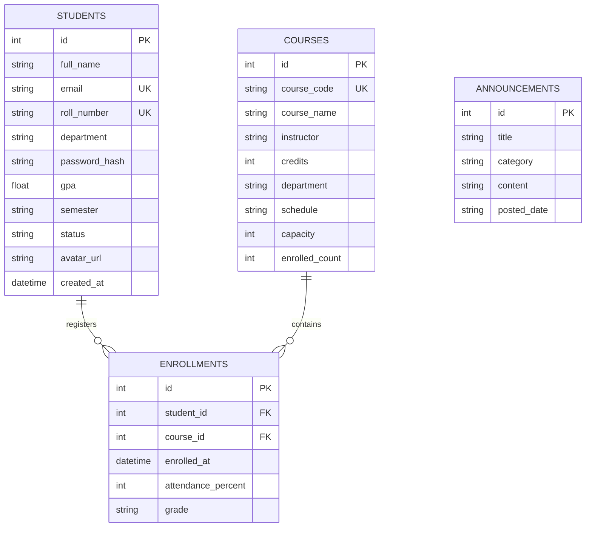

# Nexus University — Student Registration & Academic Portal

[](https://nodejs.org)
[](https://react.dev)
[](https://getbootstrap.com)
[-lightblue.svg)](https://www.sqlite.org)
[](https://jwt.io)

A clean, full-stack student registration, login, and course management web application built with **React 18, Bootstrap 5, Node.js, Express, and SQL (SQLite3)**. Built with clean separation of concerns between frontend UI, REST API routes, JWT auth middleware, and normalized SQL tables.

---

## Key Features

- **Student Registration & Login**: Account registration with password validation and hashing (`bcryptjs`, 10 salt rounds), plus `JWT` authentication (`24h` token expiry).
- **One-Click Demo Login**: Pre-seeded student profile (`alex.mercer@campus.edu`) so reviewers can test all portal features immediately.
- **Course Registration & Credit Cap**: Browse catalog courses with instructor, schedule, credits, and seat availability. Supports one-click enroll/drop while enforcing an **18-credit semester cap**, course capacity limits, and duplicate enrollment checks (`409 Conflict`).
- **Student Overview & Notices**: Live enrolled credit calculation, GPA display, attendance/grade table, and campus announcements feed.
- **Digital ID Card & Profile Settings**: Dedicated Digital ID view and profile update form (Name, Department, Avatar URL).
- **Responsive Clean UI**: Built with React 18, Vite, Bootstrap 5.3, and clean card components.

---

## Project Structure

```text
student-portal/
├── backend/
│   ├── config/
│   │   ├── db.js                     # SQLite3 connection, SQL schema & demo seed data
│   │   └── student_portal.db         # Portable SQLite database file
│   ├── controllers/
│   │   └── authController.js         # Register, login, dashboard, enroll/drop & profile APIs
│   ├── middleware/
│   │   └── auth.js                   # JWT Authorization header verification middleware
│   ├── routes/
│   │   └── authRoutes.js             # Express routes under /api/auth
│   ├── package.json
│   └── server.js                     # Express server listening on port 4005
├── frontend/
│   ├── src/
│   │   ├── context/
│   │   │   └── AuthContext.jsx       # Global React state for student session & JWT token
│   │   ├── App.jsx                   # Login/Register screens, Overview, Courses, ID Card & Settings
│   │   ├── index.css                 # Custom typography & clean card styling
│   │   └── main.jsx                  # React DOM entry point
│   ├── index.html                    # Bootstrap 5.3 CDN & root mount
│   ├── package.json
│   └── vite.config.js                # Vite dev server (port 3005) with /api proxy to :4005
├── package.json                      # Root scripts: npm start / npm run dev
├── run.bat                           # Windows 1-click startup script
├── start.js                          # Concurrent launcher for backend (:4005) & frontend (:3005)
└── README.md
```

---

## SQL Database Schema



---

## API Endpoints

### Public Endpoints
| Method | Endpoint | Body | Description |
| :--- | :--- | :--- | :--- |
| `POST` | `/api/auth/register` | `{ fullName, email, rollNumber, department, password }` | Registers student, hashes password, assigns 2 starter courses, returns JWT |
| `POST` | `/api/auth/login` | `{ email, password }` | Verifies email/password via bcrypt and returns JWT |
| `POST` | `/api/auth/demo-login` | *(None)* | Logs into the seeded demo student (`alex.mercer@campus.edu`) |
| `GET` | `/api/auth/announcements` | *(None)* | Lists campus notices |
| `GET` | `/api/health` | *(None)* | API health check |

### Protected Endpoints (`Authorization: Bearer <token>`)
| Method | Endpoint | Description |
| :--- | :--- | :--- |
| `GET` | `/api/auth/profile` | Fetches current student profile |
| `GET` | `/api/auth/dashboard` | Returns student info, enrolled courses (via SQL `JOIN`), total credits, and notices |
| `GET` | `/api/auth/courses` | Lists all courses with `is_enrolled` flag via `LEFT JOIN` |
| `POST` | `/api/auth/courses/enroll` | Enrolls student (`{ courseId }`), enforcing 18-credit max & course capacity |
| `DELETE` | `/api/auth/courses/drop/:courseId` | Drops an enrolled course and decrements `enrolled_count` |
| `PUT` | `/api/auth/profile` | Updates `fullName`, `department`, or `avatarUrl` |

---

## Quick Start

### Prerequisites
- Node.js (v18+ recommended) and npm

### 1. Clone & Install Dependencies
```bash
git clone https://github.com/siddiquddin/student-portal.git
cd student-portal

cd backend && npm install
cd ../frontend && npm install
cd ..
```

### 2. Run Both Servers Together
```bash
npm start
```
*(Or double-click `run.bat` on Windows.)*

- **Frontend UI**: `http://localhost:3005`
- **Backend API**: `http://localhost:4005`

### Demo Login Credentials
- **Email**: `alex.mercer@campus.edu`
- **Password**: `password123`
*(Or click **Try Demo Student** in the top bar.)*

---

## License

MIT License
