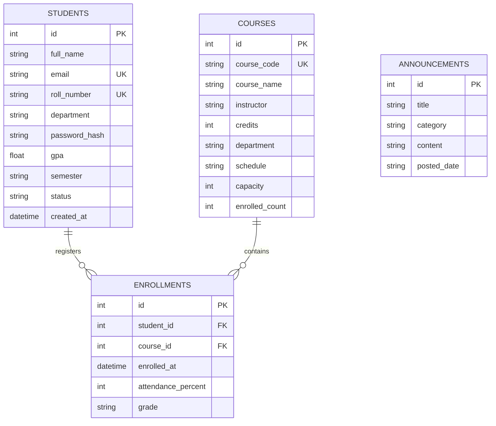

# EduPortal — Full-Stack Student Registration & Academic Management Portal

[](https://nodejs.org)
[](https://expressjs.com)
[](https://react.dev)
[](https://vitejs.dev)
[](https://www.sqlite.org)
[](https://jwt.io)

A modern, clean, full-stack student registration, authentication, and academic course management platform. Designed specifically as an impressive beginner-to-intermediate portfolio project demonstrating core web fundamentals, secure authentication, relational database modeling, and glassmorphic UI design.

---

## 🌟 Key Features

- **Secure Authentication**: User registration with input validation, password hashing using `bcryptjs` (salt rounds = 10), and stateless session authorization via JSON Web Tokens (`JWT` with 24-hour expiration).
- **One-Click Demo Login**: Pre-seeded demo account (`alex.mercer@campus.edu`) allows recruiters and interviewers to test the student dashboard instantly without registering.
- **Relational Data Modeling (SQLite3)**: Normalized database tables for Students, Courses, Enrollments (junction table for Many-to-Many relationship), and Campus Announcements.
- **Academic Course Registration**: Browse real-time course catalog with credit hours, professor information, capacity limits, and one-click enroll/drop capabilities.
- **Student Performance Dashboard**: Live calculation of enrolled credits, current GPA tracking (3.84), semester schedule, and attendance percentage.
- **Campus Notice Board**: Real-time announcements and alerts feed for academic deadlines, exam schedules, and university events.
- **Modern Glassmorphic UI**: Built with React 18, Vite, and custom CSS featuring frosted-glass backdrop filters, subtle gradients, and mobile-responsive layout.

---

## 🏗️ Architecture & Project Structure

```text
student-portal/
├── backend/
│   ├── config/
│   │   ├── db.js                     # SQLite3 database connection & table auto-seeding
│   │   └── student_portal.db         # Persistent SQLite database file
│   ├── controllers/
│   │   └── authController.js         # Register, login, demo-login, course enrollment logic
│   ├── middleware/
│   │   └── auth.js                   # JWT verification middleware protecting API routes
│   ├── routes/
│   │   └── authRoutes.js             # REST API endpoint definitions
│   ├── package.json
│   └── server.js                     # Express server configuration & CORS setup
├── frontend/
│   ├── src/
│   │   ├── context/
│   │   │   └── AuthContext.jsx       # Global React state for authenticated student & token
│   │   ├── App.jsx                   # Main layout: Auth modal, dashboard, course catalog
│   │   ├── index.css                 # Glassmorphic styles, Tailwind utilities, responsive grid
│   │   └── main.jsx                  # React DOM root entrypoint
│   ├── index.html                    # HTML5 template with Inter font
│   ├── package.json
│   └── vite.config.js                # Vite dev server with /api proxy to port 5000
├── package.json                      # Root workspace scripts (npm run dev, npm run install:all)
├── run.bat                           # 1-Click Windows execution script
├── start.js                          # Node cross-platform concurrent runner
└── README.md
```

---

## 🗄️ Database Schema & Relationships



---

## 🚀 API Endpoints Reference

### Public Authentication Routes

| Method | Endpoint | Request Body | Description |
| :--- | :--- | :--- | :--- |
| `POST` | `/api/auth/register` | `{ fullName, email, rollNumber, department, password }` | Creates new student account, hashes password, returns JWT token |
| `POST` | `/api/auth/login` | `{ email, password }` | Validates credentials with bcrypt, returns JWT token & student profile |
| `POST` | `/api/auth/demo-login` | *(None)* | Instant login as pre-configured demo student for evaluation |
| `GET` | `/api/auth/announcements` | *(None)* | Retrieves public university notices and academic alerts |

### Protected Student Routes (Requires `Authorization: Bearer <token>`)

| Method | Endpoint | Description |
| :--- | :--- | :--- |
| `GET` | `/api/auth/profile` | Fetches authenticated student profile details |
| `GET` | `/api/auth/dashboard` | Returns summary metrics: GPA, total credits, enrolled courses |
| `GET` | `/api/auth/courses` | Retrieves all courses with enrollment status for logged-in student |
| `POST` | `/api/auth/courses/enroll` | Enrolls student into course (`{ courseId }`), enforces capacity limits |
| `DELETE` | `/api/auth/courses/drop/:courseId` | Drops course and frees up seat |
| `PUT` | `/api/auth/profile` | Updates student contact email, department, or phone |

---

## 💻 Quick Start & Installation

### Prerequisites
- Node.js (v18.0.0 or higher)
- npm (v9.0.0 or higher)

### Option 1: One-Click Execution (Windows)
Double-click `run.bat` in the project root. It will automatically check dependencies and launch both servers simultaneously!

### Option 2: Manual Terminal Setup

1. **Clone the repository**:
   ```bash
   git clone https://github.com/siddiquddin/student-portal.git
   cd student-portal
   ```

2. **Install all dependencies**:
   ```bash
   npm run install:all
   ```

3. **Start both backend and frontend concurrently**:
   ```bash
   npm run dev
   ```

- **Frontend Application**: `http://localhost:5173`
- **Backend REST API**: `http://localhost:5000`

### Default Demo Credentials
- **Email**: `alex.mercer@campus.edu`
- **Password**: `password123`
*(Or click the purple **"Quick Demo Login"** button on the sign-in modal)*

---

## 🎤 Interview Talking Points & Architecture Highlights

When discussing this project with a recruiter or technical interviewer, highlight:

1. **Password Security**: *"Passwords are never stored in plain text. I implemented bcryptjs with 10 salt rounds to defend against rainbow table and brute-force attacks."*
2. **Stateless Authentication**: *"I used JSON Web Tokens (JWT) for authentication. The client stores the token in memory/localStorage and attaches it as a Bearer token in HTTP headers. The backend verifies signature integrity on protected routes using custom Express middleware."*
3. **Relational Database Design**: *"Instead of storing course lists directly inside the student record, I implemented an `enrollments` junction table with foreign keys referencing both `students` and `courses`. This enforces referential integrity and prevents duplicate enrollments using `UNIQUE(student_id, course_id)`."*
4. **Clean Code & Separation of Concerns**: *"The backend strictly decouples routing (`authRoutes.js`), business logic (`authController.js`), and database configuration (`db.js`), adhering to MVC software architecture patterns."*

---

## 📄 License

This project is licensed under the MIT License. Open source and free for academic and professional use.
