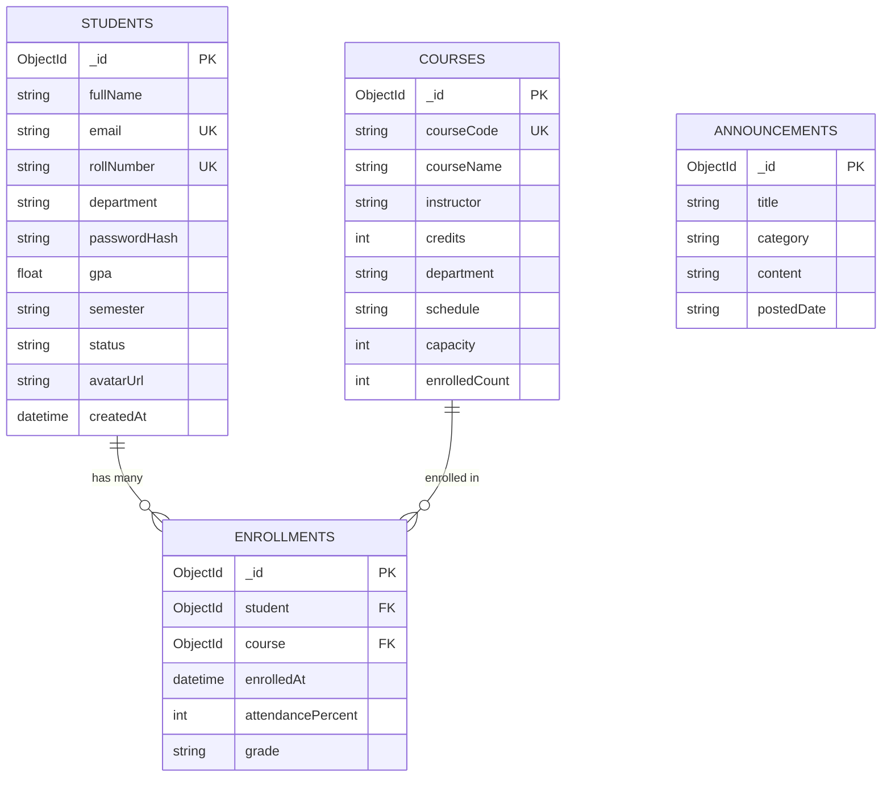

# Full-Stack Student Registration & Academic Portal (MERN Stack)

[](https://nodejs.org)
[](https://www.mongodb.com)
[](https://react.dev)
[](https://getbootstrap.com)
[](https://jwt.io)

A production-ready **MERN stack** (MongoDB Atlas, Express, React 18, Node.js) student registration, authentication, and academic course management platform. Designed with clean architecture separating the frontend client, protected REST API routes, JWT authorization middleware, and Mongoose document data models.

---

## 🌟 Key Features

- **MERN Stack Architecture**: Powered by **M**ongoDB Atlas (via Mongoose ODM), **E**xpress.js, **R**eact 18, and **N**ode.js.
- **Secure Authentication**: User registration with input validation, password hashing using `bcryptjs` (salt rounds = 10), and stateless session authorization via JSON Web Tokens (`JWT` with 24-hour expiration).
- **One-Click Demo Login**: Pre-seeded demo account (`alex.mercer@campus.edu`) allows recruiters and interviewers to test the student dashboard instantly without manual registration.
- **Academic Course Registration**: Browse real-time course catalog with credit hours, professor information, capacity limits, and one-click enroll/drop capabilities.
- **Credit Limit & Capacity Validation**: Enforces an 18-credit semester maximum, prevents double enrollments (`409 Conflict`), and checks class capacity before enrollment.
- **Student Performance Dashboard**: Live calculation of enrolled credits, current GPA tracking (3.88), semester schedule, attendance percentages, and digital ID card.
- **Campus Notice Board**: Real-time announcements and alerts feed for academic deadlines, exam schedules, and university events.
- **Responsive Clean UI**: Built with React 18, Bootstrap 5.3, and clean card components.

---

## 🏗️ Architecture & Project Structure

```text
student-portal/
├── backend/
│   ├── config/
│   │   └── db.js                     # MongoDB connection & auto-seeding of demo student & courses
│   ├── models/
│   │   ├── Student.js                # Mongoose schema for students
│   │   ├── Course.js                 # Mongoose schema for courses
│   │   ├── Enrollment.js             # Mongoose schema for course enrollments (compound index)
│   │   └── Announcement.js           # Mongoose schema for campus notices
│   ├── controllers/
│   │   └── authController.js         # Register, login, demo-login, enrollment & profile handlers
│   ├── middleware/
│   │   └── auth.js                   # JWT verification middleware protecting API routes
│   ├── routes/
│   │   └── authRoutes.js             # REST API endpoint definitions
│   ├── .env.example                  # Template with MONGODB_URI
│   ├── package.json
│   └── server.js                     # Express server listening on port 4005
├── frontend/
│   ├── src/
│   │   ├── context/
│   │   │   └── AuthContext.jsx       # Global React state for authenticated student & token
│   │   ├── App.jsx                   # Main layout: Auth modal, dashboard, course catalog
│   │   ├── index.css                 # Clean card styles & typography
│   │   └── main.jsx                  # React DOM root entrypoint
│   ├── index.html                    # Bootstrap 5.3 CDN & HTML5 shell
│   ├── package.json
│   └── vite.config.js                # Vite dev server (port 3005) with /api proxy to port 4005
├── package.json                      # Root workspace scripts (npm start / npm run dev)
├── run.bat                           # 1-Click Windows execution script
├── start.js                          # Cross-platform concurrent runner
├── .env.example
└── README.md
```

---

## 🗄️ MongoDB Document Models (Mongoose)



---

## 🚀 API Endpoints Reference

### Public Authentication Routes

| Method | Endpoint | Request Body | Description |
| :--- | :--- | :--- | :--- |
| `POST` | `/api/auth/register` | `{ fullName, email, rollNumber, department, password }` | Creates new student in MongoDB, hashes password, returns JWT token |
| `POST` | `/api/auth/login` | `{ email, password }` | Validates credentials with bcrypt, returns JWT token & student profile |
| `POST` | `/api/auth/demo-login` | *(None)* | Instant login as pre-configured demo student (`alex.mercer@campus.edu`) |
| `GET` | `/api/auth/announcements` | *(None)* | Retrieves public university notices and academic alerts |
| `GET` | `/api/health` | *(None)* | Health check returning MongoDB Atlas connection status |

### Protected Student Routes (Requires `Authorization: Bearer <token>`)

| Method | Endpoint | Description |
| :--- | :--- | :--- |
| `GET` | `/api/auth/profile` | Fetches authenticated student profile details |
| `GET` | `/api/auth/dashboard` | Returns summary metrics: GPA, total credits, enrolled courses |
| `GET` | `/api/auth/courses` | Retrieves all courses with enrollment status for logged-in student |
| `POST` | `/api/auth/courses/enroll` | Enrolls student into course (`{ courseId }`), enforces 18-credit cap |
| `DELETE` | `/api/auth/courses/drop/:courseId` | Drops course and decrements course enrolled count |
| `PUT` | `/api/auth/profile` | Updates student contact email, department, or avatar URL |

---

## 💻 Quick Start & Installation

### Prerequisites
- Node.js (v18.0.0 or higher)
- MongoDB (Local instance or free MongoDB Atlas cloud cluster)

### 1. Clone & Configure Environment
```bash
git clone https://github.com/siddiquddin/student-portal.git
cd student-portal

# (Optional) Edit backend/.env to point to your MongoDB Atlas cloud URI:
# MONGODB_URI=mongodb+srv://<user>:<password>@cluster.mongodb.net/student_portal?retryWrites=true&w=majority
```

### 2. Install Dependencies
```bash
cd backend && npm install
cd ../frontend && npm install
cd ..
```

### 3. Run Both Servers (1-Command)
```bash
npm start
```
*(On Windows, you can simply double-click `run.bat`.)*

- **Frontend Application**: `http://localhost:3005`
- **Backend REST API**: `http://localhost:4005`

### Default Demo Credentials
- **Email**: `alex.mercer@campus.edu`
- **Password**: `password123`
*(Or click the **Try Demo Student** button in the top navigation bar)*

---

## 🎤 Interview Talking Points (MERN Stack)

When presenting this project in a CDAC or software developer interview:

1. **Why MERN Stack**:
   *"I chose the MERN stack (MongoDB, Express, React, Node.js) because it provides a unified JavaScript/TypeScript development experience from database to client. Mongoose provides schema validation, middleware hooks, and type safety on top of MongoDB's flexible document model."*
2. **Data Modeling & Population**:
   *"Instead of embedding unbounded course arrays inside the student document, I created a referenced `Enrollment` collection with a compound unique index `({ student: 1, course: 1 })`. When fetching the student dashboard, I use Mongoose `.populate('course')` to join course details cleanly."*
3. **Stateless Authentication**:
   *"Passwords are encrypted using bcryptjs with 10 salt rounds. On successful login, the server issues a signed JSON Web Token (JWT) with a 24-hour expiration. Client requests attach the token in the `Authorization: Bearer <token>` header, verified by custom Express middleware on all protected routes."*
4. **Business Rule Enforcement**:
   *"Before creating an enrollment, the backend verifies that the student will not exceed the 18-credit semester ceiling and checks that `course.enrolledCount < course.capacity`, returning an HTTP 400 error if exceeded."*

---

## 📄 License

This project is licensed under the MIT License.
